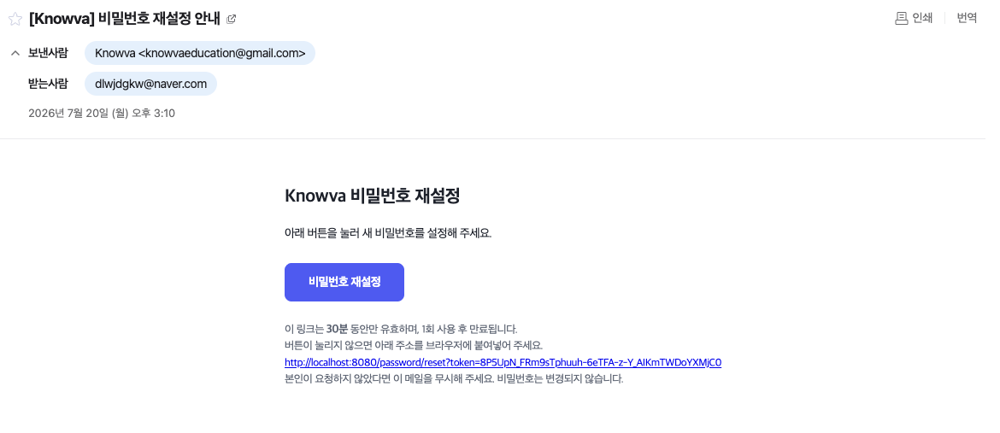
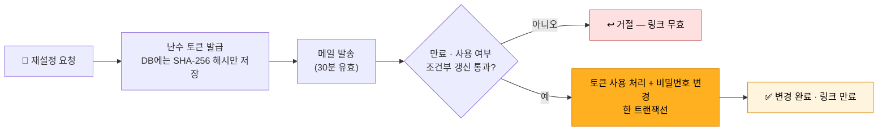
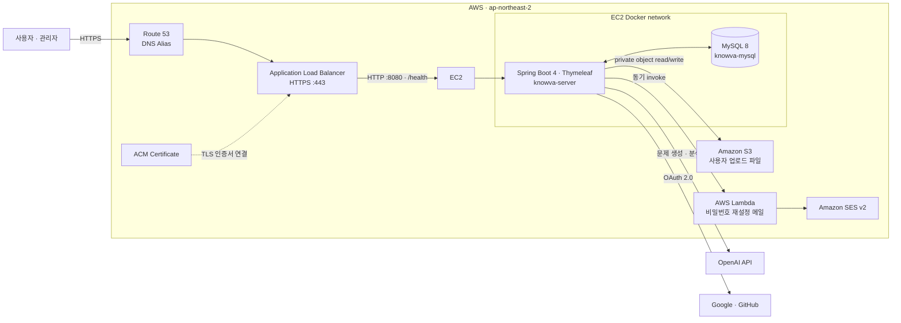
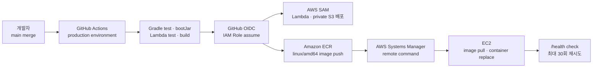

<h1 align="center">Knowva</h1>

<br/>

> 코딩 입문자를 위한 웹 학습 플랫폼 — 이론 학습 · 문제풀이 · 오답 복습 · 커뮤니티를 하나의 학습 흐름으로 연결.<br/>
> **회원가입부터 로그인 유지, 비밀번호 복구까지 — 사용자가 서비스에 들어오는 모든 길목을 담당.**

<br/>

## 프로젝트 개요

코딩 입문자가 이론 학습, 문제풀이, 오답 복습과 커뮤니티 기록을 이어갈 수 있는 웹 학습 플랫폼입니다.
7명이 함께 만든 팀 프로젝트에서 저는 웰컴 튜토리얼부터 회원가입·로그인, 비밀번호 재설정까지 사용자의 서비스 진입 흐름을 구현하고 인증·보안·세션 관리를 담당했습니다.

| | |
| --- | --- |
| **기간 · 인원** | 2026.06.17 – 07.27 · 7인 팀 (에이콘아카데미 최종 프로젝트) |
| **담당 범위** | **인증 · 세션** — 회원가입 · 일반 로그인 · Google/GitHub OAuth · 자동 로그인 · 비밀번호 재설정 · 웰컴 튜토리얼 |
| **기술** | Java 17 · Spring Boot · Spring MVC · MyBatis · MySQL · Thymeleaf |
| **인증 · 보안** | HttpSession · BCrypt · OAuth · HMAC 서명 쿠키 · Java Mail |
| **저장소** | [팀 저장소 hyunkyumlee/Acorn-E-Learning](https://github.com/hyunkyumlee/Acorn-E-Learning) · 서비스명 Knowva |

아래 설명은 팀 서비스 중 제가 담당한 인증·세션과 온보딩 기능을 다룹니다.

<br/>

## 주요 기능 (담당 범위)

| 기능 | 어떤 문제를 어떻게 해결했나 |
| --- | --- |
| **회원가입 · 일반 로그인** | 입력값 검증 후 비밀번호를 BCrypt로 해시해 저장. 계정 생성과 관련 데이터 저장은 하나의 트랜잭션으로 처리 |
| **소셜 로그인 (Google · GitHub)** | 인증과 회원 생성을 분리 — 추가 정보 입력 중 이탈해도 불완전한 계정이 남지 않음. state 대조로 콜백 위조 차단 |
| **자동 로그인** | 쿠키에 식별자 · 비밀번호 변경 시각 기반 버전 · HMAC 서명을 담아, 비밀번호를 바꾸면 이전 쿠키가 전부 무효 |
| **비밀번호 재설정** | 토큰 원문 대신 SHA-256 해시 저장, 30분 유효 · 1회 사용. 토큰 사용 처리와 비밀번호 변경을 같은 트랜잭션으로 |
| **웰컴 튜토리얼** | 방문자의 로그인 상태와 역할에 맞게 단계별 안내와 진입 화면을 연결 |

<br/>

<p align="center">
  
  
</p>

<p align="center"><sub>로그인(이메일 · Google · GitHub · 비밀번호 찾기 진입) · 비밀번호 재설정 안내 메일(30분 유효 · 1회 사용 후 만료)</sub></p>

<br/>

### 재설정 링크가 비밀번호를 바꾸기까지



변경이 실패하면 토큰 사용 처리도 함께 되돌아가 링크가 살아 있고, 성공하면 같은 링크를 다시 쓸 수 없습니다.

<br/>

## 트러블슈팅

### 1. 소셜 인증 중 이탈하면 불완전한 계정이 남는 문제

- **문제** — Google·GitHub 인증을 마치자마자 계정을 만들면, 닉네임·관심 과목 등 추가 정보 입력 중에 이탈했을 때 필수 정보가 빠진 계정이 남음
- **선택** — 인증과 회원 생성을 분리. 처음 로그인한 사용자의 인증 정보는 세션에 임시 보관하고, 추가 정보 입력을 마친 뒤에 계정과 관련 데이터를 하나의 트랜잭션으로 저장. 이미 연동된 계정은 바로 로그인하도록 분기
- **결과** — 가입 도중 이탈해도 DB에는 아무것도 남지 않고, 완성된 계정만 생성됨
- **배운 점** — 외부 인증의 성공과 우리 서비스의 회원 생성은 별개의 단계. 중간 상태를 어디에 둘지(세션 vs DB)가 데이터 정합성을 좌우함

> 📄 [`OAuthService`](ELearning/src/main/java/com/acorn/elearning/auth/service/OAuthService.java)

### 2. 비밀번호 재설정 링크가 재사용되거나, 실패 시 사용자가 갇히는 문제

- **문제** — 토큰을 사용 처리한 뒤 비밀번호 변경이 실패하면 사용자는 비밀번호를 바꾸지 못했는데 같은 링크로 다시 시도할 수도 없음. 반대로 사용 처리를 안 하면 한 링크로 여러 번 변경 가능
- **선택** — 토큰은 난수로 발급하되 DB에는 SHA-256 해시만 저장. 만료 시각과 사용 여부를 확인하는 조건부 갱신으로 미사용 토큰만 사용 처리하고, 토큰 사용 처리와 비밀번호 변경을 같은 트랜잭션으로 묶음
- **결과** — 변경이 성공하면 링크는 즉시 만료되고, 중간에 실패하면 사용 처리도 되돌아가 사용자가 같은 링크로 다시 시도 가능
- **배운 점** — 함께 성공하거나 함께 실패해야 하는 작업의 범위를 정하는 것이 트랜잭션 설계의 핵심

> 📄 [`AuthService`](ELearning/src/main/java/com/acorn/elearning/auth/service/AuthService.java)

### 3. 비밀번호를 바꿔도 이전 자동 로그인 쿠키가 살아 있는 문제

- **문제** — 자동 로그인 쿠키가 탈취됐을 때 사용자가 비밀번호를 바꿔도, 이미 발급된 쿠키로는 여전히 세션이 복원됨
- **선택** — 쿠키에 사용자 식별자와 함께 비밀번호 변경 시각 기반 버전을 담고 HMAC으로 서명. 복원 시 서명 · 계정 상태 · 버전 일치를 차례로 확인해, 하나라도 어긋나면 복원 거절
- **결과** — 비밀번호만 바꾸면 그 전에 발급된 자동 로그인 쿠키가 전부 무효가 됨. 값 위조도 서명 검증에서 차단
- **배운 점** — 상태를 클라이언트에 맡길 때는 위조(서명)와 무효화(버전) 두 가지를 함께 설계해야 함

> 📄 [`RememberMeCookie`](ELearning/src/main/java/com/acorn/elearning/security/RememberMeCookie.java) · [`RememberMeInterceptor`](ELearning/src/main/java/com/acorn/elearning/security/RememberMeInterceptor.java)

<br/>

## 회고

**얻은 것**

사용자가 서비스에 들어오는 길목 전체를 맡으며, 기능이 동작하는 경우만이 아니라 중간에 실패하거나 악의적인 입력이 들어오는 경우까지 설계하는 습관을 얻었습니다.
7명이 같은 코드베이스에서 작업하면서 제 인증 기능의 변경이 다른 팀원의 화면에 영향을 줄 때 미리 공유하고 맞추는, 접점을 먼저 합의하는 협업도 경험했습니다.

**아쉬운 것**

인증 흐름별 테스트는 작성했지만 동시 요청(같은 토큰으로 동시에 재설정 시도 등)에 대한 검증까지는 가지 못했습니다.
다시 하게 된다면 Spring Security를 도입해 직접 만든 인증 구조와 프레임워크가 제공하는 구조를 비교해 보고 싶습니다.

<br/>

<div align="center">
<sub>

**이정하** · [GitHub](https://github.com/jeonggul) · dlwjdgkw@gmail.com

</sub>
</div>

<br/>

## 팀 프로젝트 전체 문서

아래는 기존 팀 README입니다. 서비스 전체 기능과 운영 환경을 설명하며, 위의 개인 담당 범위와 구분합니다.

<details>
<summary>팀 서비스 소개 · 아키텍처 · 배포 · 기술 문서 펼치기</summary>

<p align="center">
  
</p>

<h1 align="center">Knowva</h1>

<p align="center">
  <strong>학습의 흐름을 설계하고, AI 피드백으로 다음 행동을 제안하는 게이미피케이션 코딩 학습 플랫폼</strong>
</p>

<p align="center">
  <a href="https://knowvaedu.com">서비스 바로가기</a>
  ·
  <a href="https://app.notion.com/p/E-Knowva-37b04ef58e2a803287a3e65d4ec452b9?source=copy_link">기획·산출물</a>
</p>

> 에이콘 E학습터 최종 프로젝트입니다. <br>
> **문제를 푸는 순간**에서 끝나지 않고, 학습 진도·코딩 테스트·AI 분석·커뮤니티를 하나의 학습 루프로 연결합니다.

## ✨ Why Knowva?

초보 학습자는 무엇을 공부할지, 지금 실력이 어느 정도인지, 다음에 무엇을 보완해야 하는지 판단하기 어렵습니다. Knowva는 과목별 커리큘럼을 **행성 탐험형 로드맵**으로 풀어내고, 레슨 완료와 코딩 테스트 결과를 AI 분석 및 복습 행동으로 연결합니다.

| 학습의 단절 | Knowva의 해결 방식 |
| --- | --- |
| 학습 순서가 보이지 않음 | 행성·레슨·난이도로 구성된 시각적 로드맵과 잠금 해제 |
| 풀고 끝나는 코딩 문제 | 실행 테스트, 채점, 오답 복습, 다음 단계 unlock |
| 피드백이 추상적임 | 제출 이력 기반 AI 분석과 강점·보완점·추천 학습 제안 |
| 혼자 학습하기 지루함 | 과목별 커뮤니티, 학습 기록, 반응, 콘텐츠 추천 |

## 🧭 학습 경험

```text
온보딩 · 과목 선택
        ↓
행성형 커리큘럼 → 레슨 학습 → 코딩 테스트
        ↓                         ↓
   출석 · 랭킹 · 북마크      실행 테스트 · 채점
        ↓                         ↓
        └──── AI 학습 분석 · 오답 복습 ────┘
                         ↓
              과목별 커뮤니티 · 콘텐츠 추천
```

## 🖼️ 서비스 화면

<p align="center">
  
  
  
</p>

<p align="center">
  <sub>학습 로드맵 · 레슨 목록 · 코드 에디터 및 실행 테스트</sub>
</p>

## 🚀 핵심 기능

### 1. 개인화된 학습 로드맵

- Java, Python, SQL, HTML/CSS/JS 과목별 커리큘럼을 Bronze · Silver · Gold 난이도와 행성 단위 로드맵으로 제공
- 레슨 완료·레벨 테스트·난이도 unlock 정책을 기준으로 다음 행성과 레슨을 해금
- 누비 출석 도장, 누적 점수, 북마크, 오답 복습, 주간·월간 랭킹으로 학습 지속성을 지원

### 2. AI 코딩 테스트와 실행 환경

- 과목·난이도·현재 학습 범위를 반영해 AI가 코딩 테스트 문제를 생성
- CodeMirror 6 에디터에서 코드 작성 후 실행 테스트의 표준 출력으로 즉시 확인하고, 실행 이력이 있어야 제출 가능
- 사용자 코드와 테스트 케이스를 채점하고, 문제별 제출 상태와 최종 시험 결과를 저장
- AI raw 응답에 정답 로직이 섞여도 학습자·분석 AI에는 공통 TODO starter code만 전달해 평가 공정성을 유지

### 3. AI 학습 분석

- 시험 결과와 풀이 이력을 바탕으로 강점, 보완점, 다음 학습 행동을 분석
- 요청 토큰과 성공 보고서를 기준으로 중복 분석 생성을 막고, 실패한 생성 요청은 재시도 가능하게 관리
- 분석 결과를 대시보드와 오답 복습 흐름으로 연결

### 4. 학습 커뮤니티와 추천 콘텐츠

- 과목·게시판·정렬 필터 기반의 커뮤니티와 Milkdown 기반 Markdown/기본 모드 에디터 제공
- 본문 이미지 첨부, 댓글, 좋아요, 스크랩, 신고와 관리자 moderation 이력으로 운영 가능한 게시판 구성
- 현재 과목에 맞는 동영상·설치 가이드 등 추천 콘텐츠를 연결

- 오답노트를 Markdown 파일로 내려받거나 커뮤니티 게시글 초안으로 이어서 작성 가능

### 5. 계정·결제·권한 관리

- 이메일 로그인, Google·GitHub OAuth, Lambda·SES 기반 비밀번호 재설정 메일 흐름 제공
- 세션 기반 인증과 사용자·관리자 역할 분리, 공통 validation·예외 응답·idempotency 처리 적용
- Kakao Pay와 Toss Payments 기반 프리미엄 결제·권한 부여 흐름 제공

## ⚙️ 운영 아키텍처



- Route 53 alias가 ALB로 요청을 전달하고, ACM 인증서가 연결된 ALB가 HTTPS를 종료한다.
- ALB는 `/health` 상태 검사를 통과한 EC2의 Dockerized Spring Boot 앱으로만 요청을 전달한다. 앱과 MySQL은 같은 Docker network에서 통신한다.
- 업로드 파일은 private S3에 저장하고, 브라우저에는 S3 URL을 직접 노출하지 않는다. 앱의 same-origin endpoint가 권한을 확인한 뒤 streaming한다.
- 비밀번호 재설정은 EC2 앱이 Lambda를 동기 호출하고, Lambda가 SES v2로 메일을 전송한다.

## 🚚 배포 흐름



1. `main` push 또는 수동 실행이 production GitHub Environment의 workflow를 시작한다.
2. Spring Boot test·`bootJar`와 Lambda test·build를 통과한 뒤 GitHub OIDC로 AWS IAM Role을 assume한다. long-lived AWS access key는 저장하지 않는다.
3. SAM이 Lambda와 private S3를 배포하고, Lambda에 invalid request smoke test를 수행한다.
4. Git SHA 태그와 `latest` 태그의 `linux/amd64` Docker image를 ECR에 push한다.
5. SSM이 EC2에서 새 image를 pull하고, S3 모드면 기존 로컬 업로드를 동기화한 뒤 컨테이너를 교체한다.
6. `http://localhost:8080/health`가 최대 30회 안에 성공해야 deployment가 완료된다.

운영은 `MAIL_TRANSPORT=lambda`, `KNOWVA_STORAGE_MODE=s3`로 Lambda·SES와 private S3를 사용한다. 전환·복구를 위해 코드 차원에서는 `smtp|lambda`, `local|mirror|s3` adapter도 유지한다.

## 🧱 Tech Stack

| 구분 | 기술 |
| --- | --- |
| Backend | Java 17, Spring Boot 4.0.6, Spring MVC, Spring Security, Validation, MyBatis |
| View | Thymeleaf, HTML/CSS/JavaScript, CodeMirror 6, Milkdown 7, Marked, DOMPurify, esbuild |
| Data | MySQL 8, MyBatis, H2 test runtime |
| AI · External | OpenAI API, Google OAuth 2.0, GitHub OAuth, Kakao Pay, Toss Payments |
| Infra | Docker, EC2, ALB, Route 53, ACM, ECR, Systems Manager, Lambda, SES v2, private S3, AWS SAM |
| CI/CD | GitHub Actions, GitHub Environment, OIDC IAM Role |
| Test | JUnit 5, Spring Boot Test, MyBatis Test, H2, Gradle |

## 📂 프로젝트 구조

```text
.
├── ELearning/
│   ├── src/main/java/com/acorn/elearning/
│   │   ├── learning/     # 온보딩, 커리큘럼, 레슨, 레벨 테스트
│   │   ├── exam/         # AI 코딩 테스트, 실행, 채점
│   │   ├── analysis/     # AI 학습 분석과 대시보드
│   │   ├── community/    # 게시글, 댓글, 반응, 신고
│   │   ├── practice/     # 문제 풀이와 오답노트
│   │   ├── ranking/      # 점수·주간/월간 랭킹
│   │   ├── content/      # 과목별 추천 콘텐츠
│   │   ├── auth/         # 로그인, OAuth, Lambda 비밀번호 재설정
│   │   ├── payment/      # 프리미엄 결제와 권한 부여
│   │   ├── storage/      # local/mirror/S3 object storage adapter
│   │   └── common/       # API 응답, 예외, AI client, idempotency
│   ├── src/main/resources/
│   │   ├── templates/    # Thymeleaf screens
│   │   ├── static/       # CSS, JavaScript, 서비스 이미지
│   │   └── mappers/      # MyBatis XML mappers
│   ├── src/main/frontend/ # CodeMirror·Milkdown bundle source
│   └── Dockerfile
├── docs/
│   ├── sql/              # DDL, demo setup, curriculum, community seed data
│   └── 최종 문서/         # WBS, 발표 자료 등 최종 산출물
├── mail-lambda/           # Java 17 기반 SES v2 password-reset Lambda
├── infra/aws/template.yaml # Lambda, private S3, EC2 runtime IAM 정책 SAM template
└── .github/workflows/deploy.yml
```

## 🔗 Links

- Service: [knowvaedu.com](https://knowvaedu.com)
- Planning & deliverables: [E Knowva Notion](https://app.notion.com/p/E-Knowva-37b04ef58e2a803287a3e65d4ec452b9?source=copy_link)
- Database documents: [docs/sql](docs/sql)


</details>
